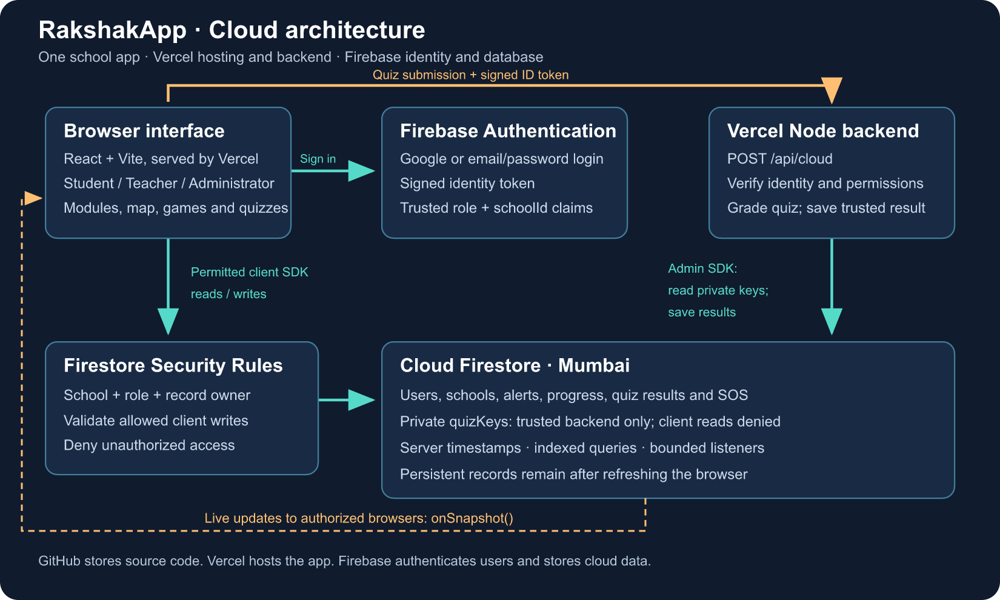
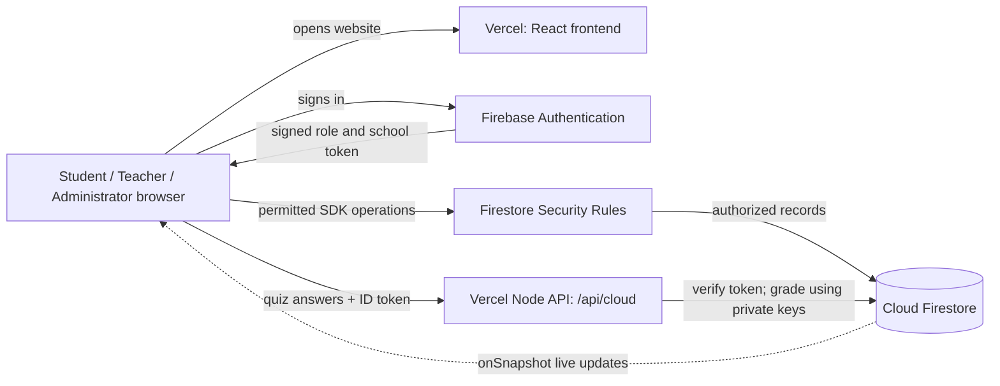
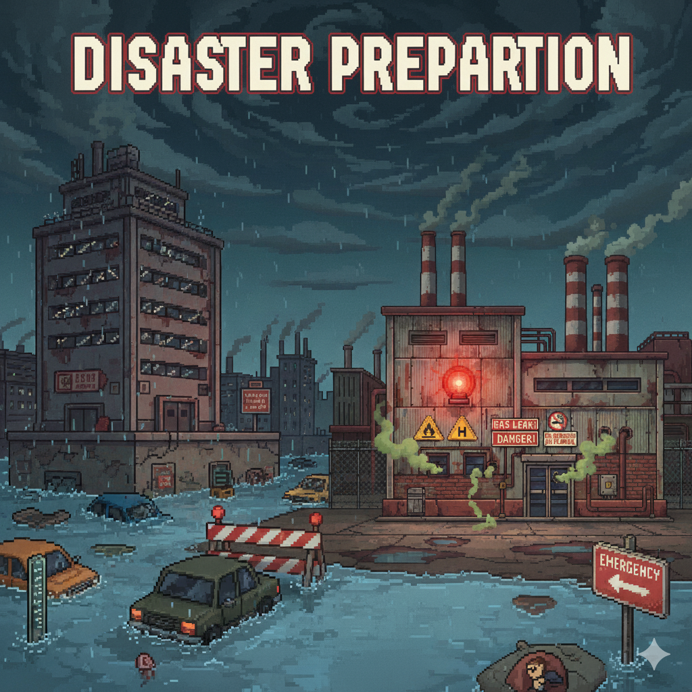

# RakshakApp — School Disaster Preparedness in the Cloud

RakshakApp helps students learn disaster safety, practise through quizzes and games, and receive school advisories. Teachers and administrators can monitor school activity. It addresses a real **Education-domain** problem: making school disaster preparedness repeatable, accessible and trackable.

**[Open the live application](https://rakshakapp-cloud.vercel.app/)** · **[Administrator dashboard](https://rakshakapp-cloud.vercel.app/dashboard/admin)** · **[Teacher presentation guide](docs/TEACHER_WALKTHROUGH.md)** · **[Assignment checklist](docs/REQUIREMENTS.md)**

| Current project | Value |
|---|---|
| Application | Existing RakshakApp, upgraded without replacing its design |
| Public deployment | `https://rakshakapp-cloud.vercel.app` |
| Firebase project | `rakshakapp-cloud` — display name **RakshakApp Cloud** |
| Database | Cloud Firestore, Standard edition, `(default)` database |
| Database region | `asia-south1` — Mumbai |
| Vercel project | `neha-mongias-projects/rakshakapp-cloud` |
| Source branch | `feat/cloud-full-stack`; published separately from `main` |
| Verified deployment date | 14 November 2026 |

The owner approved the new Firebase and Vercel projects because the signed-in accounts could not access the original deployment resources. The original `punjab-prepared-ecosystem` project and old `rakshakapp.vercel.app` deployment were not modified. The new public URL above is the application to demonstrate.

## 1. Understand the parts first

| Term | Easy explanation | What it does here |
|---|---|---|
| Frontend | The screens a person sees and clicks | React/Vite pages, map, modules, games and dashboards |
| Backend | Code running on a trusted server | Vercel Node function verifies identity and grades quizzes |
| Firebase | Google's platform containing several cloud services | Provides Authentication and Firestore |
| Firebase Authentication | The login service | Google and email/password accounts; each user has a UID |
| Cloud Firestore | The database inside Firebase | Saves alerts, progress, results, schedules and private school requests |
| Security Rules | Database access checks | Enforce school boundaries, roles and record ownership |
| Vercel | The service hosting the published app | Serves the pages over HTTPS and runs `/api/cloud` |
| GitHub | Where the project source is stored | Code, history, rules, indexes, tests and documentation |

**Firebase and Firestore are not competing databases. Firestore is one service within Firebase.** Authentication accounts and Firestore user profiles are also different: an account proves identity, while a profile contains application information.

## 2. Architecture



The browser can make permitted Firestore requests directly through the Firebase SDK. Security Rules enforce those requests. Privileged operations use the Vercel backend, which independently verifies the Firebase token because Admin SDK access bypasses client rules.



**Example — completing a quiz:**

1. A student signs in. Firebase supplies a signed token identifying their account, role and school.
2. The reading page uses the existing multilingual curriculum; published quiz questions load from Firestore.
3. Answer indexes and the token are sent to `/api/cloud` on Vercel.
4. The backend validates identity and membership, reads private grading keys, calculates the score and saves the result and completion state in a transaction.
5. The student can refresh and still see the saved attempt. An authorized school dashboard receives the new result through its listener.

**Example — a live alert:** an administrator creates an alert → Firestore saves it → a student's school-scoped `onSnapshot()` listener receives it → the student's screen updates without refreshing.

## 3. Features and their actual behavior

| Feature | What is implemented | Important boundary |
|---|---|---|
| Authentication | Google and email/password login, protected routes, trusted role/school claims | New signups need a trusted school assignment |
| Learning | Eight EN/HI/PA disaster modules, saved completion state | Reading content remains static reference material |
| Quizzes | Published cloud questions, server-side grading, saved history and pagination | Private keys cannot be read by student clients |
| Educational game | Existing Kaplay game, saved scores and badges | Game scores are self-reported, not secure examinations |
| School alerts | Administrator create/read/edit/delete; live school delivery | School communication, not a public emergency broadcast service |
| Staff dashboard | Real recent-record statistics and quiz charts | Summarizes the latest 100 records per collection |
| Punjab risk map | Existing district map and filters; configurable school advisories | District reference data is static; no live weather or sensor feed |
| SOS | Private school location request, administrator acknowledgement/resolution and deletion | Does not dispatch police, ambulance or other emergency services |
| Guide bot / voice | Multilingual guideline lookup and browser speech features | No external LLM, OpenAI or Whisper integration is claimed |
| Activity report | School PDF export using real recent records | Not an official compliance certification |

### Project images

These are original curriculum and game assets used by the existing application.

<p>
  
  
</p>



The architecture diagram describes the current cloud implementation. AI personalization, AR drills, IoT monitoring and native mobile apps remain future scope, even where older landing-page copy mentions related ideas.

## 4. Check Firebase and Firestore yourself

Open the **[Firebase Console for RakshakApp Cloud](https://console.firebase.google.com/project/rakshakapp-cloud/overview)** using the Google account that owns this project. Console access uses owner/IAM permissions; student logins do not grant access to the Firebase Console.

### A. Show the login accounts

1. Open **Security → Authentication** (or search for Authentication).
2. Open **Users**. Each login has a **User UID** and provider information.
3. Open **Sign-in method**. Google and Email/Password should be enabled.
4. Open **Settings → Authorized domains**. The production hostname `rakshakapp-cloud.vercel.app` is allowed for Google login.

What to say: **“Firebase Authentication manages login. The UID connects a login to its application records.”** Do not display passwords, private key files or secret environment-variable values.

### B. Show the saved database records

1. Open **Databases & Storage → Firestore**, or use **[the database Data tab](https://console.firebase.google.com/project/rakshakapp-cloud/firestore/databases/-default-/data)**.
2. Select the `(default)` database and the **Data** tab.
3. Click `quizResults`, then a document. Inspect `quizId`, `score`, `total`, `percent`, `userId`, `schoolId` and `createdAt`.
4. Open `learningProgress` to see completed module state.
5. Open `quizzes` to see published questions; open `learningModules` for the seeded curriculum catalog.
6. After creating a classroom demo alert, open `alerts` to show that it is a real saved record.

**Collection → document → field** is the Firestore structure. For example:

```text
quizResults/                    collection
  demo-student_attempt-id        document (example ID)
    userId: "demo-student"       field
    schoolId: "demo-school"
    quizId: "1"
    score: 5
    total: 5
    percent: 100
    createdAt: <Firestore Timestamp>
```

This is an illustrative document shape, not a credential or an actual account UID.

Firestore normally shows a collection in the Data tab only after it has a document. An empty `alerts`, `gameProgress` or `sosRequests` collection may not be visible yet. An empty screen is not proof that its feature is missing.

### C. Show database security and indexing

- **Rules:** find the checks for `role`, `schoolId` and `userId`, and the denial of client access to `quizKeys`. These checks enforce database permissions; hiding a button alone does not secure data.
- **Indexes:** the app now uses 12 configured composite index shapes for school/user filtering and timestamp sorting. Four retired drill indexes may remain in the cloud and are unused.
- **Usage:** shows database activity and quotas. It is not evidence of a configured backup or guaranteed uptime.

The Console owner may inspect private `quizKeys` through trusted IAM access. That does **not** mean a student can read them from the app. A real student-client read was tested and denied.

## 5. Database collections

| Collection | Purpose | Who normally accesses it through the app |
|---|---|---|
| `users` | School profile and display information | Owner and authorized same-school staff |
| `schools` | School identity | Assigned members |
| `alerts` | School advisories | School members read; school administrators manage |
| `learningModules` | Seeded learning catalog | Assigned members read |
| `learningProgress` | Completed modules | Owner writes; owner/same-school staff read |
| `quizzes` | Published questions without private keys | Assigned members read |
| `quizKeys` | Private authoritative grading keys | Trusted backend only |
| `quizResults` | Authoritative grades/history | Backend writes; owner/same-school staff read |
| `gameProgress` | Scores and badges | Owner creates; authorized staff read |
| `sosRequests` | Sensitive school SOS/location requests | Owner and own-school administrators; teachers denied |
| `riskInformation` | Configurable school map advisories | School members read; administrators manage |

The initial verified data snapshot on 14 November 2026 contained 8 modules, 8 quizzes, 8 private key documents, 2 quiz results, 1 progress record, 2 profiles and 1 school. Authentication had 3 accounts, including 1 unassigned account. These counts will change as the app is used. Full field/access details are in [DATABASE_SCHEMA.md](docs/DATABASE_SCHEMA.md).

## 6. Roles and school isolation

| Action | Student | Teacher | Administrator |
|---|---|---|---|
| Read own-school alerts and schedules | Yes | Yes | Yes |
| Save own permitted progress/results | Yes | Yes | Yes |
| View other students' educational records in the same school | No | Yes | Yes |
| Publish/edit/delete school alerts | No | No | Yes |
| View another person's SOS location | No | No | Own-school only |
| Assign student/teacher school membership | No | No | Through the trusted backend |
| Make oneself an administrator | No | No | No; bootstrap is an owner operation |
| Read another school's private records | No | No | No |

Authorization uses signed Firebase **custom claims** containing `role` and `schoolId`. The Firestore profile's `role` field is not a self-service permission switch. Do not try to promote a student by editing a profile in the browser.

For a real two-browser demonstration, create a separate student account through the app. Copy its UID from Authentication → Users. In the administrator dashboard, enter that UID, select **Student**, and choose **Assign within school**. Sign the student out and in again so the new claims are loaded. Use the same process with **Teacher** to demonstrate staff access. Never publish shared demo passwords.

## 7. A simple classroom demonstration

1. Open the public app and show the Education problem, map and multilingual modules.
2. Sign in as the administrator in browser/profile A; sign in as an assigned student in browser/profile B.
3. In A, publish a clearly labelled **classroom demo** alert. B receives it without refreshing. Show its document in Firestore → Data → `alerts`.
4. In B, complete a quiz. Show the saved `quizResults` document, refresh B, and show history still present.
5. Show the authorized staff dashboard updating its recent-record statistics.
6. Show Rules and Indexes, then explain why another student or school cannot read those private records.
7. Finish with the architecture diagram, actual tests, limitations and future scope.

Use [TEACHER_WALKTHROUGH.md](docs/TEACHER_WALKTHROUGH.md) for exact Console clicks, a short speech, likely questions and expected evidence. Use [DEMO_SCRIPT.md](docs/DEMO_SCRIPT.md) for the longer feature demonstration.

## 8. Run locally and deploy updates

The deployed app works without keeping your laptop or Terminal running. For local development, use Node 22 or 24 and run these commands from `frontend`:

```sh
npm ci
# Only for a fresh checkout; do not overwrite an already configured file:
cp .env.example .env.local
# Fill the public Firebase values and private backend values locally.
npm run dev:full
```

Open `http://localhost:8081`. `dev:full` runs the frontend and the same backend handler together. `npm run dev` starts Vite alone and does not run privileged grading.

| Setting group | Location | Visibility |
|---|---|---|
| `VITE_FIREBASE_*` (6 values) | Local `.env.local`; Vercel public build Config | Compiled into the browser; identifiers, not database authorization |
| `FIREBASE_PROJECT_ID`, `FIREBASE_CLIENT_EMAIL`, `FIREBASE_PRIVATE_KEY` | Local ignored environment; Vercel server Secrets | Backend only; never put a private key in a `VITE_` variable |

Build and check:

```sh
npm run build
npm run typecheck
npm test
# Requires Java 21+; uses demo-rakshak rather than live data:
npm run test:rules
```

Publish reviewed changes to the existing linked Vercel project:

```sh
npx vercel@latest login
npx vercel@latest deploy --prod --scope neha-mongias-projects
```

GitHub stores source. This project was published using the Vercel CLI; a GitHub push does not currently trigger an automatic Vercel deployment. See [DEPLOYMENT.md](docs/DEPLOYMENT.md) for safe setup and update details.

## 9. Testing, scalability and availability

Verified: production Google login; real cloud alert delivery between independent clients; authenticated backend quiz grading; persisted result readable by its student; denial of private answer-key access; working indexed query shapes; production build and TypeScript checks. The unit suite passed 16 tests; a separate emulator run passed 9 security/synchronization tests. `npm test` skips emulator tests unless run under the emulator. See [TESTING.md](docs/TESTING.md), [SETUP_VERIFICATION.md](docs/SETUP_VERIFICATION.md) and [PUBLISHED.md](docs/PUBLISHED.md) for scope and checkpoints.

Queries filter by school/user, sort by server timestamps and cap live feeds at 100 records. Quiz history supports cursor pagination. Listeners unsubscribe on unmount or identity change. These are cloud-friendly design choices, not a completed load test. Vercel/Firebase manage infrastructure, while actual quotas, plans, outages and network conditions still matter. The project is on Firebase Spark; unlimited usage, guaranteed uptime, configured backups or multi-region recovery are not claimed.

## 10. Limitations and future enhancements

- Game scores and reading completion are self-reported; the app does not verify a person's physical safety.
- The school SOS inbox is not emergency dispatch and does not guarantee a response.
- Static district references do not provide live hazard, weather or IoT monitoring.
- Browser speech, geolocation permissions and available voices depend on the device.
- Current staff summaries use a recent bounded sample, not official preparedness certification.
- Baseline lint findings and dependency advisories remain documented. Institutional deployment needs further security, accessibility and operational review.
- No configured backup schedule, application rate limiting, App Check enforcement or institutional retention program is claimed.
- The educational source contains curriculum answer mappings; server grading prevents forged stored scores, not all forms of examination cheating.
- Future scope: personalized AI education, AR practice, IoT sensors, native mobile apps, aggregate reporting and tested recovery procedures.

## 11. Source and further documentation

```text
frontend/src/              Existing React interface, cloud services and role guards
frontend/api/cloud.js      Trusted Vercel endpoint
frontend/server/           Admin SDK setup and grading policy
frontend/scripts/          Explicit provisioning, seeding and verification commands
frontend/tests/            Auth, routes, backend, listeners and Firestore rules tests
firestore.rules            Client-side access and data validation
firestore.indexes.json     Composite query index definitions
firebase.json              Rules/index/emulator configuration
docs/                     Architecture, audit, schema, reports and teacher guide
```

[Assignment checklist](docs/REQUIREMENTS.md) · [Project report](docs/PROJECT_REPORT.md) · [Architecture](docs/CLOUD_ARCHITECTURE.md) · [Security](docs/SECURITY.md) · [Baseline audit](docs/AUDIT.md) · [Teacher guide](docs/TEACHER_WALKTHROUGH.md)

Developed by Team RakshakApp. The historical README is retained for provenance; its old integration claims are superseded by this current implementation description.

## Current release — 20 November 2026

Virtual drills have been removed from routes, navigation, dashboards, reports, translations and client database permissions. Retired drill records, if present, are inaccessible to app clients. The app continues to support modules, quizzes, games, school alerts, map advisories and private SOS requests. Two school administrators have been provisioned through trusted Firebase Admin tooling; sign out and sign back in after a role change.
