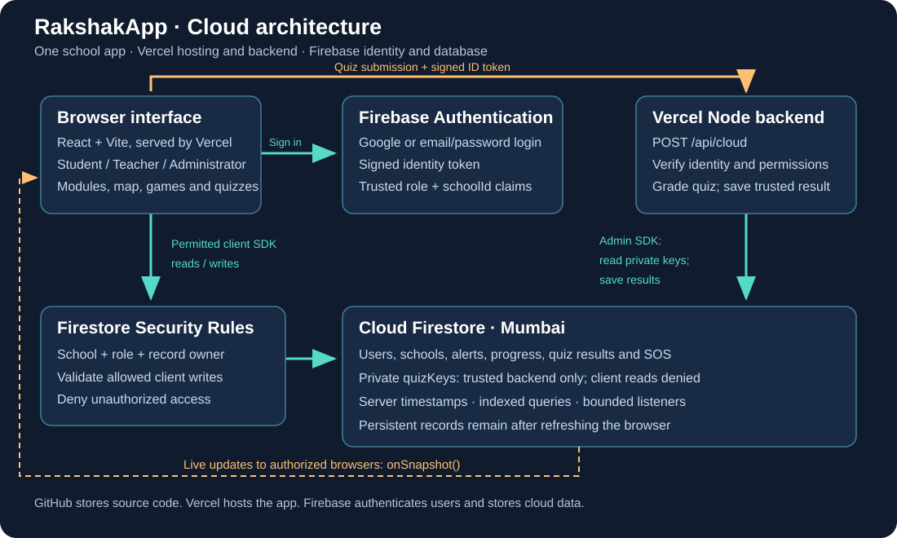
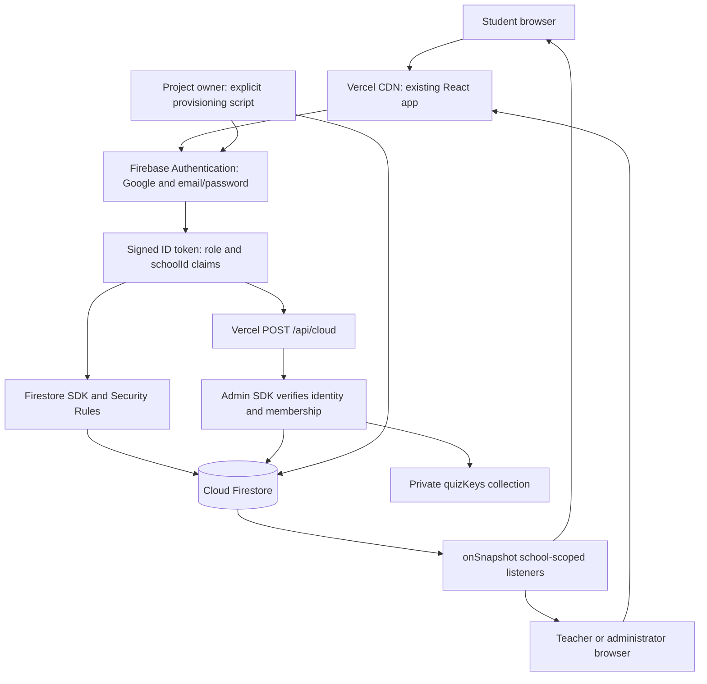

# Cloud architecture

RakshakApp keeps its existing React/Vite interface. The owner-approved current Firebase project is `rakshakapp-cloud`; the published Vercel app is https://rakshakapp-cloud.vercel.app/. The CLI uploads the existing frontend folder as the application root. The original cloud resources were not modified.

The client can publish permitted school alerts, read school schedules, write private progress and submit school SOS requests. Security Rules enforce identity, roles, school boundaries, field validation and immutable identities. UI routing improves usability; it is not the security boundary.

The backend independently verifies Firebase tokens, requires trusted membership, grades answers using private keys and writes authoritative quiz results in a transaction. Attempt IDs make retry submissions idempotent. Administrators may assign student/teacher membership within their school; creation or replacement of administrator privileges requires a project-owner CLI workflow.

Firebase Cloud Functions are unnecessary for this implementation. A Vercel Node function provides the trusted backend with the same existing frontend domain. Running Firebase Cloud Functions in production generally requires billing configuration; confirm current plan requirements before choosing that alternative. Vercel and Firestore have their own quotas and billing limits; using Vercel does not guarantee zero cost.

## Scale and availability

Static content is served by Vercel; stateless backend instances use managed Firebase Auth and Firestore. Queries filter by school and, for private student data, user ID. Composite indexes support sorted retrieval. Live feeds cap each collection at 100 recent records and unsubscribe on identity change or unmount. `src/lib/cloud.ts` includes cursor retrieval for longer histories. Current admin aggregates describe this recent sample, not lifetime totals. Add materialized counters or reporting exports for large installations.

Firestore database location, edition, backup schedules, point-in-time recovery, Vercel region, SLA eligibility and production monitoring were not inspected. No uptime percentage, cross-region replica, automatic backup or disaster recovery guarantee is asserted. Before institutional use, document the actual region, data retention, budgets, alerts, recovery procedures and provider plan. An outage can delay school alerts; the app is educational and is not an emergency dispatch system.

Public reference: [Firebase custom claims](https://firebase.google.com/docs/auth/admin/custom-claims), [Firestore rule conditions](https://firebase.google.com/docs/firestore/security/rules-conditions), [Vercel Node functions](https://vercel.com/docs/functions/runtimes/node-js).
